# 🌱 Green Nest Nursery — Online Botanical Plant Store & Care Platform

<p align="center">
  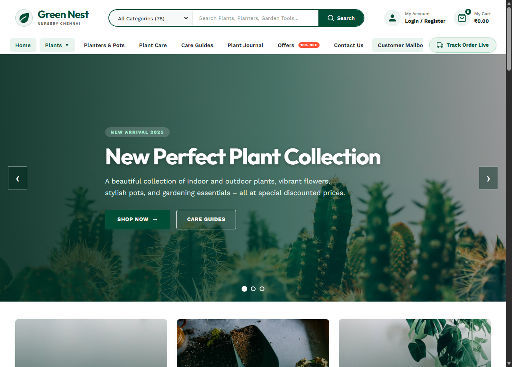
</p>

<p align="center">
  <strong>A full-stack, enterprise-grade botanical eCommerce platform built with Django, Python, HTML5/CSS3, and Google SMTP Integration.</strong>
</p>

<p align="center">
  <a href="#-key-features"></a>
  <a href="#-tech-stack"></a>
  <a href="#-real-email-system"></a>
  <a href="#-quick-start"></a>
</p>

---

## 📖 Project Overview

**Green Nest Nursery** is a modern, high-performance web platform designed specifically for plant lovers, urban gardeners, and botanical enthusiasts. It combines a smooth eCommerce shopping experience with real-time automated order tracking, personalized plant care schedules, an editorial plant journal, and a dedicated staff administration suite.

The system features real-time transactional email delivery via **Google's official SMTP Relay (TLS 587)**, sending beautiful HTML invoices upon checkout and automated botanical unboxing/care guides when an order is marked **Delivered**. It also includes an in-app customer mailbox failsafe, coupon management, and air-purifying plant classification.

---

## 📸 Visual Walkthrough & System Screenshots

### 1. Storefront & Catalog Browsing
| Homepage & Hero Banner | Plant Shop & Smart Filters |
| :---: | :---: |
|  | 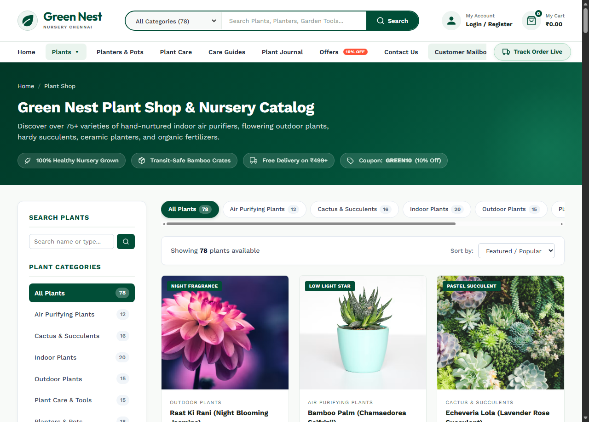 |
| *Hero section with seasonal botanical collections & offers* | *Category filtering (Indoor, Outdoor, Air Purifying, Planters)* |

---

### 2. Product Detail & Botanical Specifications
| Botanical Product Specs & Planters | Customer Care Encyclopedia |
| :---: | :---: |
| 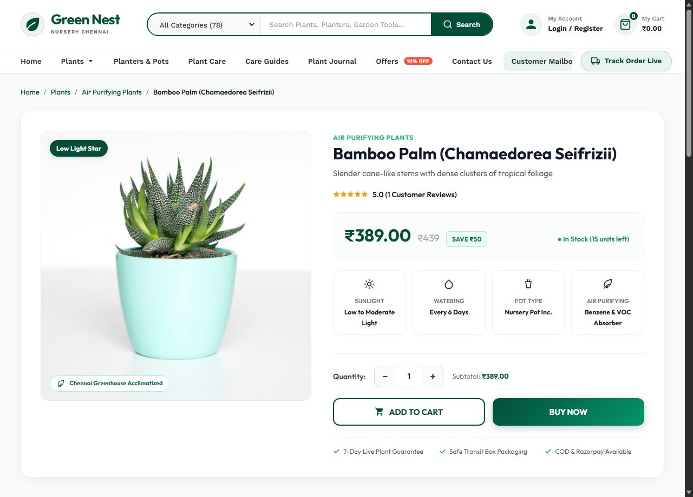 | 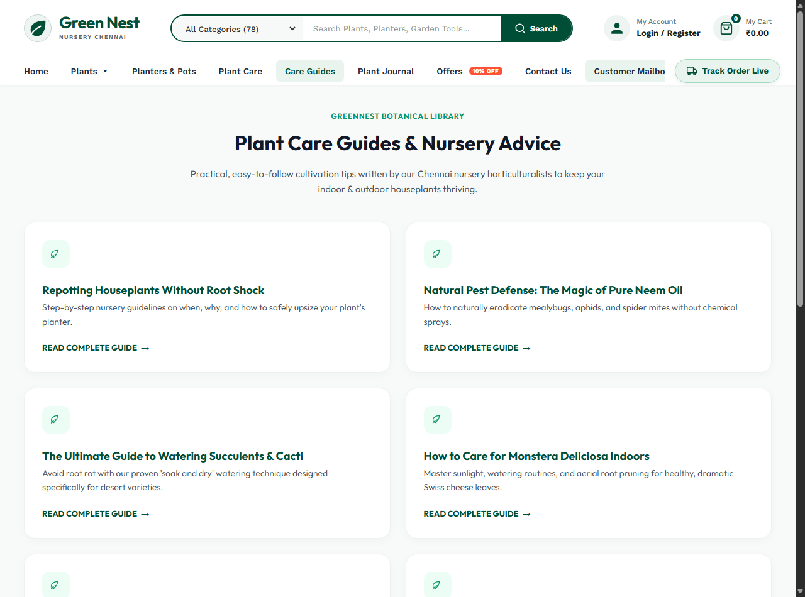 |
| *Light/water requirements, pot selections, and verified reviews* | *Step-by-step nursery guides for plant parents* |

---

### 3. Shopping Cart & Secure Checkout
| Shopping Bag & Coupon Engine | Clean Secure Checkout |
| :---: | :---: |
| 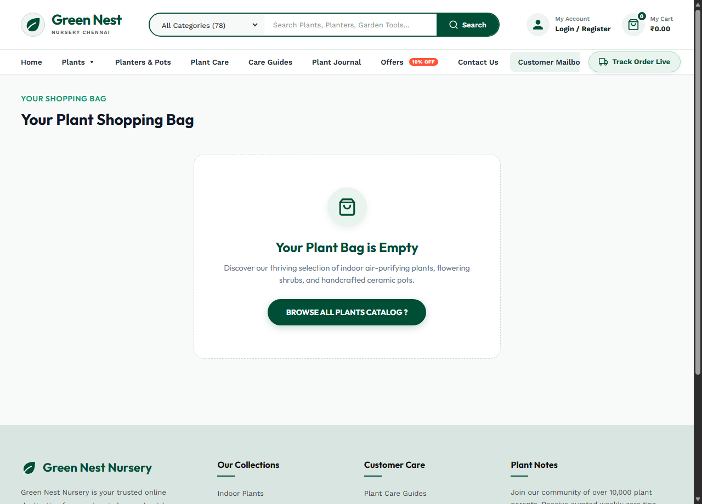 | 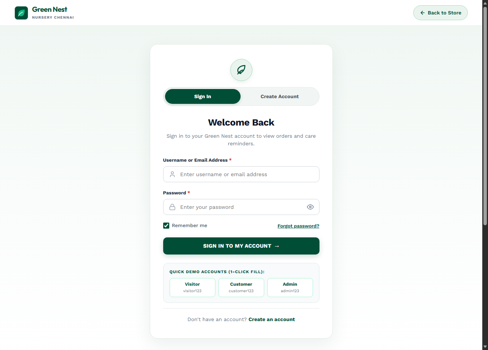 |
| *Live subtotal, quantity modification, and `GREEN10` discount* | *Customer shipping address with COD or Online payment* |

---

### 4. Distraction-Free Authentication (Login & Register)
| Minimalist Sign In Page | Modern Customer Registration |
| :---: | :---: |
|  | 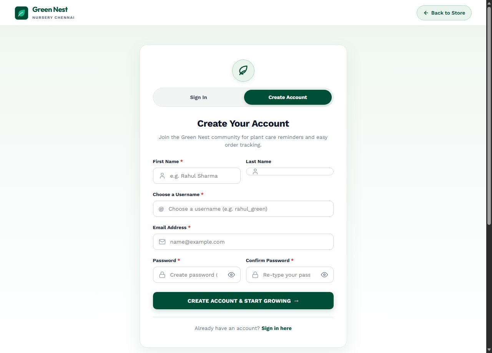 |
| *Distraction-free auth layout with password view toggling* | *Clean account creation with instant password confirmation* |

---

### 5. Order Tracking & Real-Time Delivery Notifications
| Live Shipment & Delivery Status | In-App Customer Mailbox |
| :---: | :---: |
| 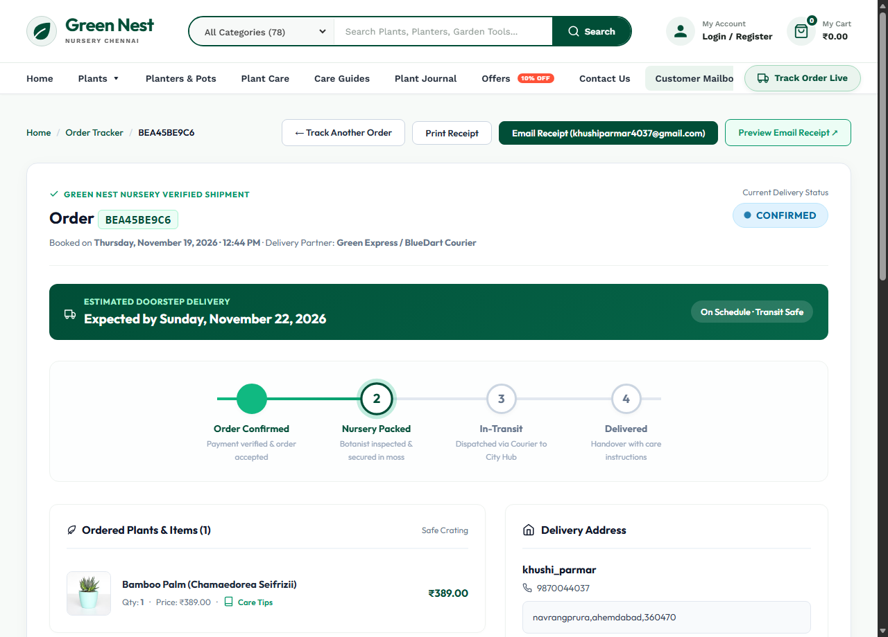 | 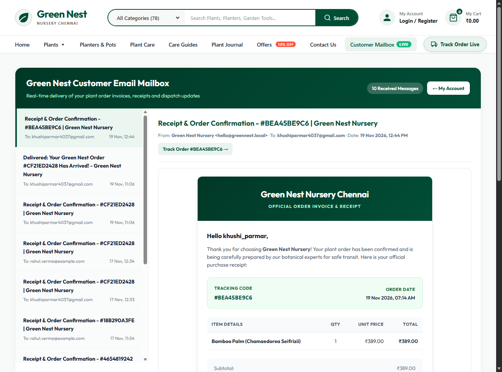 |
| *Visual status tracker with unboxing botanical tips* | *Failsafe digital invoice inbox directly inside the app* |

---

### 6. Staff Management & Admin Dashboard
| KPI Revenue & Sales Analytics | Plant Inventory & Stock Management |
| :---: | :---: |
| 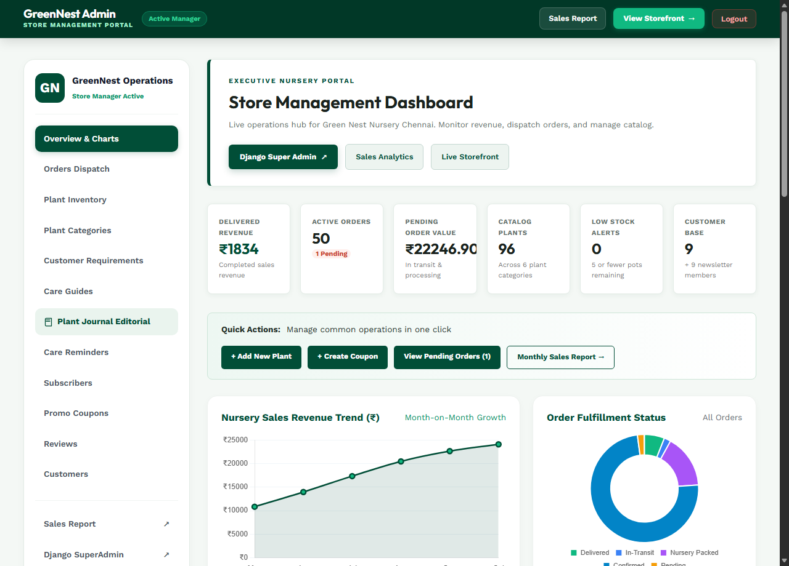 | 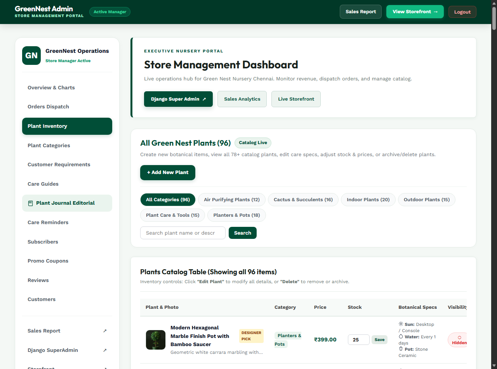 |
| *Clean KPI metric cards, sales volume, and order totals* | *Full catalog inventory management & low-stock alerts* |

| Live Order Fulfillment & Status Updates | Editorial Plant Journal |
| :---: | :---: |
| 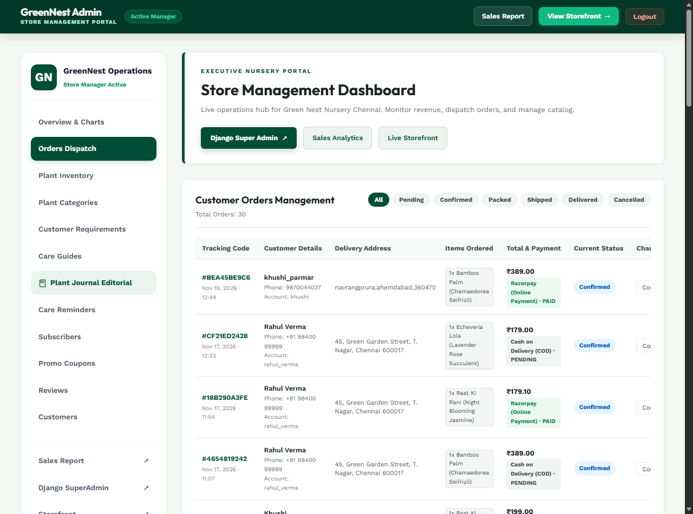 | 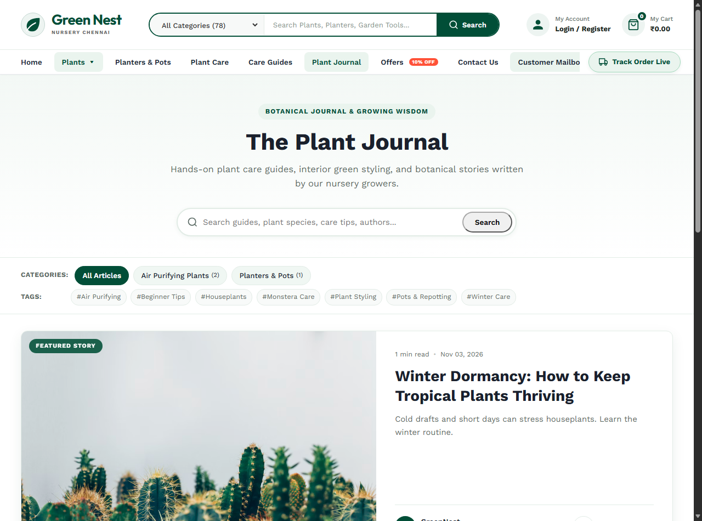 |
| *1-Click dispatch, processing, and delivery status updates* | *Botanical articles, care guides, and gardening wisdom* |

---

## ⚡ Key Features

- **Botanical Plant Catalog:** Filter plants by light needs (Indirect Sun, Low Light, Full Sun), maintenance levels, watering frequency, pot types, and air-purifying properties.
- **Smart Shopping Cart & Coupons:** Seamless cart management with coupon validation (e.g. `GREEN10` for 10% off).
- **Distraction-Free Auth:** Polished, responsive login and registration pages with floating headers, eye password toggles, and 1-click demo role fill.
- **Real Google SMTP Email Dispatch:** Automated dispatch of responsive HTML invoices and delivery confirmation emails with unboxing instructions directly to the customer's Gmail inbox.
- **In-App Customer Mailbox (`/inbox/`):** Built-in inbox storing digital bills and delivery notices inside the website so customers never lose their receipts.
- **Order Tracking System:** Real-time visual tracking from *Order Placed* → *Processing* → *In Transit* → *Delivered*.
- **Admin Management Hub (`/manage/`):** Staff-only dashboard with sales revenue metrics, pending orders, plant inventory control, order dispatch status transitions, and sales reports.
- **Plant Care Reminders:** Customers can schedule watering and fertilization reminders saved directly to their account profile.
- **Editorial Plant Journal:** Rich articles on plant care, gardening tips, pest control, and indoor plant aesthetics.

---

## 🛠️ Tech Stack

- **Backend:** Python 3.13+, Django 6.0 (MTV architecture)
- **Database:** SQLite3 (development) / PostgreSQL ready (production)
- **Frontend:** Semantic HTML5, Vanilla CSS3 (Custom Botanical UI Design System), Responsive Mobile Grid, SVG Icons
- **Email Delivery:** SMTP via Google Mail Relay (`smtp.gmail.com` on Port 587 with TLS) + `EmailMultiAlternatives`
- **Security:** CSRF Protection, Password Hashing (PBKDF2 SHA-256), Python-dotenv (`.env`) for zero credential exposure
- **Asset Pipeline:** WhiteNoise for static asset compression and caching

---

## 🚀 Quick Start Guide

### 1. Clone the Repository
```bash
git clone https://github.com/parmarkhushi2026-max/greennest.git
cd greennest
```

### 2. Create and Activate Virtual Environment
```bash
# Windows
python -m venv .venv
.\.venv\Scripts\activate

# macOS / Linux
python3 -m venv .venv
source .venv/bin/activate
```

### 3. Install Dependencies
```bash
pip install -r requirements.txt
```

### 4. Configure Environment Variables (`.env`)
Create a `.env` file in the project root:
```env
DJANGO_SECRET_KEY=your-secure-django-secret-key
DJANGO_DEBUG=True

# Real Google SMTP Credentials
EMAIL_HOST=smtp.gmail.com
EMAIL_PORT=587
EMAIL_HOST_USER=your-email@gmail.com
EMAIL_HOST_PASSWORD=your-16-digit-app-password
DEFAULT_FROM_EMAIL=Green Nest Nursery <your-email@gmail.com>
```

### 5. Run Database Migrations
```bash
python manage.py migrate
```

### 6. Start the Local Development Server
```bash
python manage.py runserver 127.0.0.1:8000
```
Open your browser and navigate to: **[http://127.0.0.1:8000/](http://127.0.0.1:8000/)**

---

## 🔑 Demo Accounts & Credentials

| Role | Username / Email | Password | Access Area |
| :--- | :--- | :--- | :--- |
| **Store Administrator** | `admin` | `admin123` | Full Admin Dashboard (`/manage/`) & Django Admin (`/admin/`) |
| **Verified Customer** | `khushiparmar4037@gmail.com` | `Khushi@259` | Customer Account (`/account/`), Orders, Cart & Checkout |
| **Demo Customer** | `rahul_verma` | `customer123` | Customer Account, Order History, Plant Care Reminders |
| **Guest / Visitor** | `visitor` | `visitor123` | Browse Catalog, Read Journal, Add to Bag |

---

## 📧 Real Email Architecture Explanation

The automated transactional email system uses **Django's `django.core.mail`** framework connected via **Google's TLS 587 SMTP relay**:
1. **Trigger on Checkout:** When a customer completes checkout, `send_order_receipt_email(order)` dynamically compiles `store/email/order_receipt.html` with order items, pricing, shipping address, and tracking code, then dispatches the HTML invoice directly to the customer's inbox.
2. **Trigger on Delivery:** When an admin marks an order as `DELIVERED` in the management dashboard, `send_order_delivery_email(order)` sends an official delivery confirmation containing first-week unboxing advice (indirect sunlight acclimation, soil moisture check).
3. **Database Archiving:** All emails are simultaneously persisted in `CustomerEmailInbox` so users can review their messages inside the web app at `/inbox/`.

---

## 📜 License & Acknowledgments

This project is open-source and built for botanical nursery management and eCommerce study. Developed with passion by **Khushi Parmar** and the Green Nest development team.
